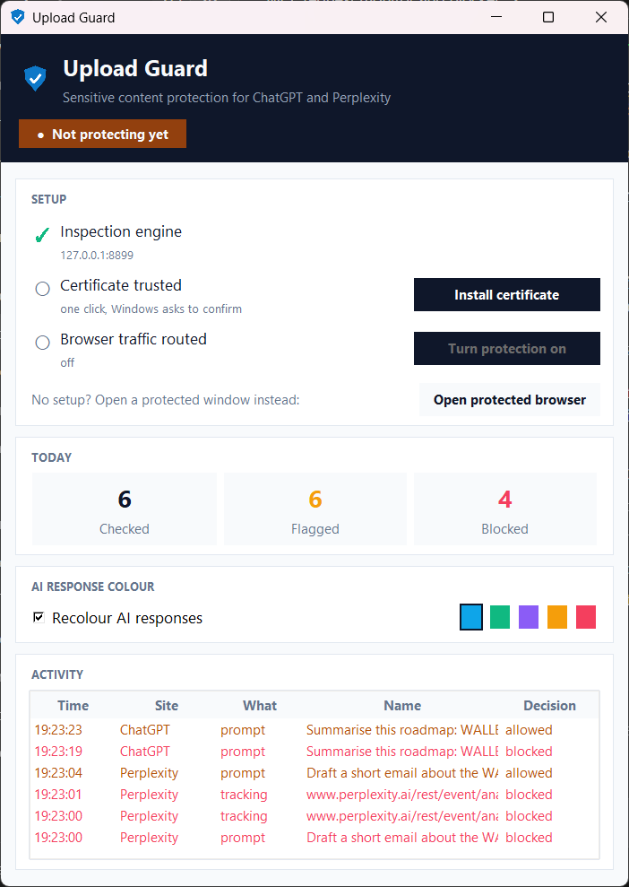
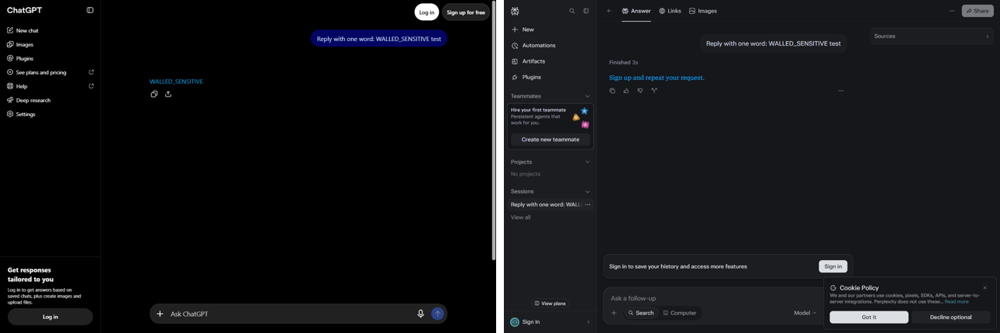

# Sensitive Upload Guard

**A standalone desktop DLP for ChatGPT and Perplexity.** It checks every text prompt and file upload (text, PDF, image) the browser sends to chatgpt.com and perplexity.ai for the marker `WALLED_SENSITIVE`, *before it leaves the computer*. When the marker is found, the request is held while a **native desktop dialog** asks **Continue** or **Cancel**. It also recolours AI-generated responses on both sites.

**No browser extension, plugin or add-on.** It's one Python desktop application with a local inspecting proxy, the same architecture enterprise DLP tools use.

| Desktop app | Native Windows dialog (Task Dialog) |
| --- | --- |
|  |  |

| AI responses recoloured on ChatGPT and Perplexity (live, through the proxy) |
| --- |
|  |

> **Demo video:** _add link_ · **Architecture:** [docs/ARCHITECTURE.md](docs/ARCHITECTURE.md) · **Demo script:** [docs/DEMO.md](docs/DEMO.md)

## How it works

```
 Chrome / Edge / Firefox  (no extension)
        │  only chatgpt.com, perplexity.ai and their upload storage (proxy auto-config)
        ▼
 ┌─────────────────────────── Upload Guard desktop app (Python) ───────────────────────────┐
 │  local inspecting proxy (mitmproxy engine, 127.0.0.1)                                    │
 │   • decrypts only the two sites + their upload storage; everything else passes through  │
 │   • reads each outgoing prompt / file   → text, PDF, OCR for images and scanned pages    │
 │   • marker found → HOLDS the request → native Continue/Cancel dialog                     │
 │       Continue → forwarded unchanged      Cancel → answered locally, never leaves the PC │
 │   • adds a colour stylesheet to the two sites' pages → AI responses recoloured            │
 │  window: setup, protection on/off, colour, live activity, audit log                      │
 └──────────────────────────────────────────────────────────────────────────────────────────┘
        ▼
 chatgpt.com · perplexity.ai · their file storage
```

| Requirement | How it is met |
| --- | --- |
| Standalone desktop application | A Python/Tk desktop app. Nothing is installed in the browser. |
| Inspect prompts **before** they are sent | Every send request (`POST`) to the two sites is read and held at the proxy until a decision |
| Inspect file uploads before they are transmitted | The upload request's bytes (multipart, or a raw upload to the site's cloud storage) are inspected before being forwarded |
| Text, PDF and image files | Text decoding, PDF text layer (`pypdf`), and the OS's own OCR (Windows.Media.Ocr / Apple Vision) for images **and scanned PDF pages** |
| Native dialog, says prompt vs file, shows the prompt or file name | Windows Task Dialog: "Sensitive content in a text prompt / in a file", with the prompt text, or the file name, type and where the marker was found |
| No marker: no interaction | Clean requests pass straight through; the user sees nothing |
| **Continue** | The original request is forwarded byte-for-byte |
| **Cancel** | The request is answered locally (403) and never leaves the PC. Both sites keep the prompt in the box, so the user can edit and resend. |
| Recolour AI responses on both sites | A small stylesheet is added to the two sites' HTML as it passes through the proxy. The user's own messages are left unchanged. |
| Don't interfere with normal browsing | A proxy auto-config file sends **only** the two sites (and their upload storage) to Upload Guard; everything else goes direct. Even within that, only those hosts are decrypted. |

**Also handled:** Perplexity's analytics beacon repeats the prompt text, and so do tracking calls on both sites. Those never open a dialog; they're **dropped unless the user already approved that exact text**, so a cancelled prompt can't leak through telemetry either.

## Setup (Windows 10/11)

Requires **Python 3.12+**.

```bash
git clone https://github.com/Raj4478/sensitive-upload-guard.git
cd sensitive-upload-guard
python -m venv .venv
.venv\Scripts\activate
python -m pip install -r requirements.txt
python -m upload_guard
```

The Upload Guard window opens and starts its inspection engine. Then follow the two setup steps in the window. **Each is started by you, and each can be undone from the same button:**

1. **Install certificate.** Upload Guard creates its own certificate authority on first run (*"Upload Guard local inspection CA"*, unique to this PC; the key never leaves it). Click **Install certificate** and confirm Windows' security prompt. It's stored for your user only (no admin rights).
2. **Turn protection on.** This sets your user's *automatic proxy configuration* to Upload Guard's local PAC file, which sends only ChatGPT, Perplexity and their upload storage through it. Chrome, Edge and Firefox pick it up immediately. **Turn protection off**, or closing the app, restores your previous setting exactly.

Now use chatgpt.com and perplexity.ai normally in your usual browser.

**No setup?** Click **Open protected browser**. It opens Chrome or Edge with a separate profile that uses Upload Guard and trusts only its certificate, with no system changes. Chrome shows a notice about a command-line flag in this mode; that's expected.

**Try it** with the sample files in `samples/` (regenerate them with `python samples/make_samples.py`):

| File | Expected |
| --- | --- |
| `clean.txt`, `clean.pdf`, `clean.png` | uploads with no dialog |
| `sensitive.txt` | dialog, found in *text* |
| `sensitive.pdf` | dialog, found in *page 2* |
| `sensitive.png` | dialog, found in *image text (OCR)* |
| `sensitive-scanned.pdf` | dialog, found in *page 1 image (OCR)* |

### Other commands

```bash
python -m upload_guard check samples/sensitive.pdf   # inspect files from the terminal
python -m upload_guard dialog-test                   # show the native dialog once
python -m upload_guard browser                       # open a protected browser window
python -m upload_guard proxy                         # run the engine without the window
```

**Settings:** `%APPDATA%\UploadGuard\config.json` (colour, dialog timeout, `unreadable_policy`: `ask`/`allow`/`block`, ports). **Logs and audit trail:** `%APPDATA%\UploadGuard\logs\` and `audit.log`. The audit log records a SHA-256 hash, never the content.

**Uninstall:** in the app, click **Turn protection off**, then **Remove** (certificate). Then delete `%APPDATA%\UploadGuard`.

### macOS

Use a virtual environment (Homebrew Python refuses system-wide pip):

```bash
python3 -m venv .venv && source .venv/bin/activate
python3 -m pip install -r requirements.txt
python3 -m upload_guard
```

**Install certificate** adds the CA to your login keychain (macOS asks for your password). For routing, set *System Settings → Network → (your network) → Proxies → Automatic proxy configuration* to the URL the app shows. Or use **Open protected browser**, which needs no setup. The inspection engine, including Apple Vision OCR, passes the full test suite on macOS in CI; the end-to-end run was done on Windows.

## Tests

```bash
python -m pytest -q                                   # 47 tests: detection, extraction/OCR, request parsing,
                                                      # site rules, decisions, the proxy add-on, the local CA
cd tests/e2e && npm install && node run.mjs --live    # 18 end-to-end tests through the real proxy
```

The end-to-end test starts the real proxy and drives **real Chrome** through it, with no extension and no system changes. It runs against a local test site (prompts, multipart and raw storage uploads, tracking beacons, all seven sample files) **and the live ChatGPT and Perplexity sites**, and clicks the real native dialog through Win32. Latest result: **18/18 passed** ([tests/e2e/e2e-results.txt](tests/e2e/e2e-results.txt)).

## Security and privacy

- **Decrypts only what it must:** the two sites and their upload storage. All other traffic is never routed to Upload Guard, and even routed storage hosts stay encrypted unless a protected site named them.
- **The local CA is unique to the PC.** Its private key sits in the user's profile and is used only by the local proxy. Removing it is one click.
- **Upstream certificates are still verified,** so the proxy never weakens the connection to the real sites.
- **Nothing leaves the PC for inspection:** OCR and parsing are local. The audit log stores hashes, not content.
- **Fail closed:** if Upload Guard stops while routing is on, the two sites don't load until it runs again, rather than loading unprotected. Closing the app normally turns routing off.
- **Cancel is the safe default** in the dialog; an unanswered dialog cancels after 120 s.

## Limitations

- **Certificate trust is required** for network-level inspection of HTTPS. This is inherent to the approach (and to every network DLP). The app makes it explicit and reversible.
- **Apps that pin certificates or use their own network stack** (e.g. native desktop apps) are out of scope; this targets the two web apps in a browser.
- **Site changes:** detection doesn't depend on page structure (it reads requests), but the recolour stylesheet targets the sites' stable `data-` attributes and may need updating after a redesign.
- **OCR quality:** very small, rotated or handwritten text may not be read. If OCR fails, the file counts as "could not be checked" and the user is asked.
- **A previous version** used a browser extension as the sensor. It's kept only as the git tag `extension-version` and isn't part of this application.

## License

MIT
