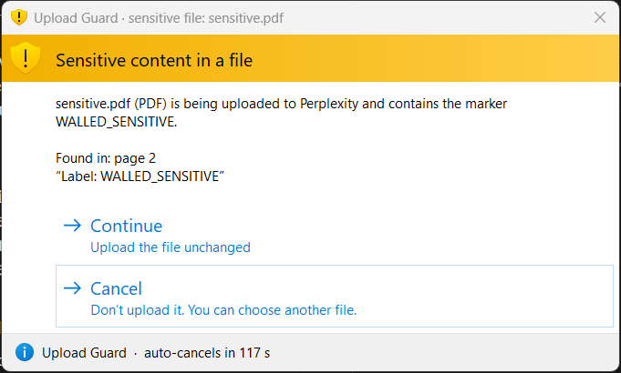
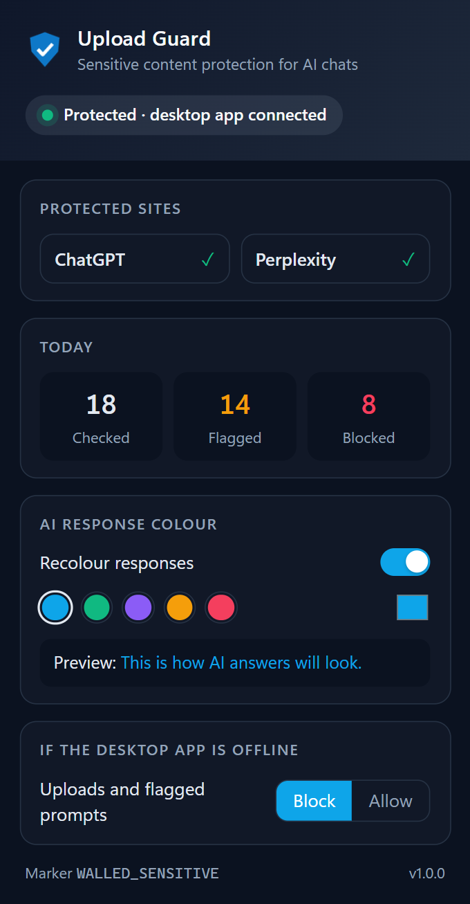
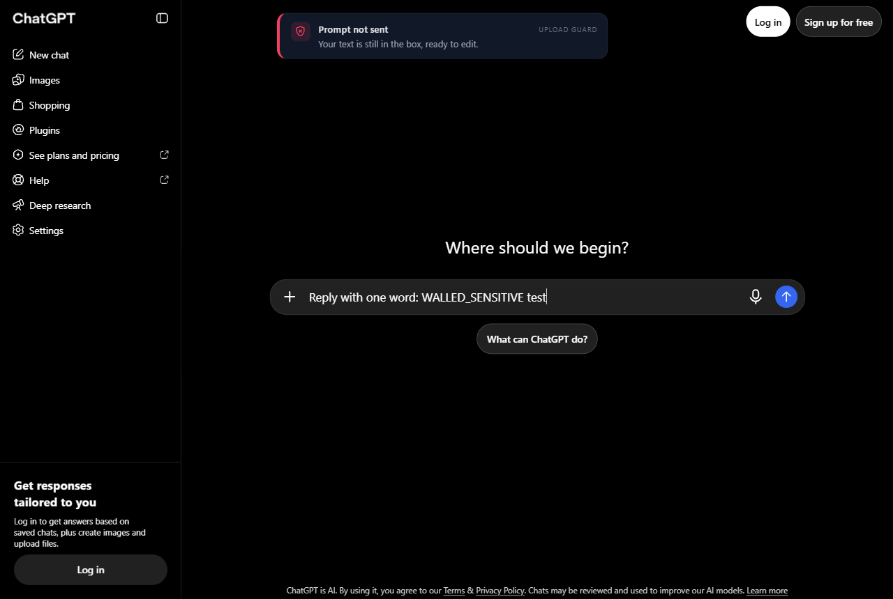

# Sensitive Upload Guard

**A lightweight desktop DLP for ChatGPT and Perplexity.** It checks every text prompt and file upload (text, PDF, image) for the marker `WALLED_SENSITIVE` *before* it leaves the browser. When the marker is found, a **native desktop dialog** asks **Continue** or **Cancel**. It also recolours all AI-generated responses on both sites.

| Native Windows dialog (Task Dialog) | Extension popup |
| --- | --- |
|  |  |

| On-page notice (live ChatGPT) | AI responses recoloured (ChatGPT, Perplexity) |
| --- | --- |
|  |  |

> **Demo video:** _add link_ · **Architecture:** [docs/ARCHITECTURE.md](docs/ARCHITECTURE.md) · **Demo script:** [docs/DEMO.md](docs/DEMO.md)

## What it does

| Requirement | Behaviour |
| --- | --- |
| Prompt without the marker | Sent as usual. Nothing is intercepted, and there is no delay. |
| Prompt containing `WALLED_SENSITIVE` | Native dialog: "text prompt … ChatGPT/Perplexity", with the prompt text |
| Text / PDF / image file containing the marker | Native dialog **before upload**, naming the file, its type and where the marker was found (e.g. *page 2*, *image text (OCR)*) |
| **Continue** | The original prompt or file goes through unchanged, exactly as the user sent it |
| **Cancel** | Nothing is sent. The prompt stays in the box to edit or resend; the file input is emptied so the user can pick again. With several files, only the flagged ones are removed. |
| AI responses | Recoloured on both sites (colour configurable). The user's own messages are left as they are. |

Uploads are covered whichever way they happen: the **file picker**, **drag and drop** and **pasting** a file or screenshot.

Detection tolerates real-world noise: case, `WALLED SENSITIVE`, a marker split across lines in a PDF, and OCR misreads such as `WA11ED_SENS1TIVE`. PDFs are read from their text layer; **scanned pages and images are OCR'd with the operating system's own engine**, so nothing extra needs installing on Windows 10/11 or macOS.

## How it works (short)

```
 chatgpt.com / perplexity.ai tab
 ┌──────────────────────────────────┐   chrome.runtime    ┌──────────────┐  native messaging  ┌────────────────────────────┐
 │ content.js (sensor)              │ ──────────────────► │ background.js│ ─────────────────► │ upload_guard desktop app   │
 │ holds Enter / Send / file events │ ◄────────────────── │ (relay)      │ ◄───────────────── │ • text / PDF / OCR reading │
 │ replays or drops them            │   allow|continue|   └──────────────┘   stdin/stdout     │ • marker detection         │
 │ responses.css recolours answers  │   cancel                                JSON            │ • native Win32/macOS dialog│
 └──────────────────────────────────┘                                                          │ • audit log                │
                                                                                               └────────────────────────────┘
```

The extension is only a sensor. All inspection, OCR and the dialog live in the Python desktop app. The full design is in [docs/ARCHITECTURE.md](docs/ARCHITECTURE.md).

## Setup (Windows 10/11; Chrome, Edge or Brave)

Requirements: **Python 3.10+**.

```bash
git clone https://github.com/Raj4478/sensitive-upload-guard.git
cd sensitive-upload-guard
python -m pip install -r requirements.txt
```

**1. Register the desktop app with your browsers.** This writes a per-user registry entry; no admin rights are needed.

```bash
python -m upload_guard install
```

**2. Load the extension:** open `chrome://extensions` (or `edge://extensions`), turn on **Developer mode**, click **Load unpacked**, and choose the `extension` folder. Its ID will be `aioadbeodagpdhphhhodimcmfghmadoj`; it's fixed by the key in the manifest, and it's the only extension the desktop app accepts.

**3. Check it's connected:** click the shield icon in the toolbar. It should say **"Desktop app connected"**. You can also change the response colour there.

**4. Try it:** generate the demo files, then use them on chatgpt.com or perplexity.ai. File uploads need a logged-in account on both sites.

```bash
python samples/make_samples.py
```

| File | Expected |
| --- | --- |
| `clean.txt`, `clean.pdf`, `clean.png` | uploads with no dialog |
| `sensitive.txt` | dialog, found in *text* |
| `sensitive.pdf` | dialog, found in *page 2* |
| `sensitive.png` | dialog, found in *image text (OCR)* |
| `sensitive-scanned.pdf` | dialog, found in *page 1 image (OCR)* |

### macOS (and Linux)

Homebrew's Python refuses system-wide `pip install` ("externally-managed-environment", [PEP 668](https://peps.python.org/pep-0668/)), so use a virtual environment. **Run `install` from inside it**: the browser launcher is pinned to the Python that runs `install`, and that one has `pypdf` and Pillow.

```bash
python3 -m venv .venv
source .venv/bin/activate
python3 -m pip install -r requirements.txt
python3 -m upload_guard install
```

Don't use `--break-system-packages`; it can damage the Homebrew Python. On macOS, `install` registers Chrome, Edge, Brave, Chromium and Arc if they're installed. Keep Chrome in a normal window, not full screen, so the dialog opens on the same desktop Space.

The macOS build was tested on a MacBook Air (macOS 26, Homebrew Python 3.14, Chrome): ChatGPT prompts, Continue/Cancel, uploads and Vision OCR work end to end. The inspection engine also passes the full test suite on CI's macOS runner. See the known issue below for Perplexity on macOS.

On a network with broken IPv6, `pip` can hang; force IPv4 for that one install:

```bash
python3 -c "import socket,runpy,sys;o=socket.getaddrinfo;socket.getaddrinfo=lambda *a,**k:[x for x in o(*a,**k) if x[0]==socket.AF_INET];sys.argv=['pip','install','-r','requirements.txt'];runpy.run_module('pip',run_name='__main__')"
```

**Updating an existing install:**

```bash
git pull
source .venv/bin/activate      # macOS/Linux
python3 -m pip install -r requirements.txt
python3 -m upload_guard install
```

Then reload the extension in `chrome://extensions`, and reload any open ChatGPT or Perplexity tabs.

### Useful commands

```bash
python -m upload_guard check samples/sensitive.pdf   # inspect files from the terminal
python -m upload_guard dialog-test                   # show the native dialog once
python -m upload_guard uninstall                     # remove the browser registration
```

**Settings:** `%APPDATA%\UploadGuard\config.json`:

- `dialog_timeout_seconds` (default 120). An unanswered dialog cancels.
- `unreadable_policy`: `ask` (default), `allow` or `block`. This applies to supported files that couldn't be read, e.g. a password-protected PDF.
- `audit_log` (default true).

**Logs and audit trail:** `%APPDATA%\UploadGuard\logs\host.log` and `audit.log`. The audit log records a SHA-256 hash, never the content.

## Tests

```bash
python -m pytest -q          # 32 tests: detection, text/PDF/OCR extraction, host protocol
cd tests/e2e && npm install && node run.mjs --live   # 23 browser tests, real Chrome + real dialogs
```

The browser test loads the extension into real Chrome. It drives a local copy of a chat page **and the live ChatGPT and Perplexity sites**, and clicks the real native dialog through Win32. Latest result: **23/23 passed** ([tests/e2e/e2e-results.txt](tests/e2e/e2e-results.txt)).

## Limitations and trade-offs

- **The browser half is a Chromium extension** (Chrome, Edge, Brave). A desktop app alone can't see a prompt before the page sends it, and can't cancel it cleanly: HTTPS hides the content, and blocking at the network level leaves the web app in an error state with the text lost. An extension can see it, and keeps "Cancel" harmless. Firefox would need a small port of the manifest.
- **Site markup changes:** prompt boxes and send buttons are found by accessibility labels and stable `data-` attributes, with fallbacks, never by generated class names. A redesign of either site may still need a selector update; it's all in one list at the top of `content.js`.
- **Files must come from the page:** uploads through a browser file input, drag and drop or paste are covered. A site using the newer File System Access API (`showOpenFilePicker`) would need an extra hook; neither site uses it today.
- **OCR quality:** very small, rotated or handwritten text in images may not be read. If OCR fails completely, the file is treated as "could not be checked" and the user is asked (`unreadable_policy`).
- **Perplexity on macOS (open):** on one Mac, Perplexity showed "Desktop app not reachable" while ChatGPT worked in the same Chrome profile. The desktop app was never started, so the failure is inside Chrome. That notice now includes Chrome's actual error in brackets, and the extension's sender check was relaxed to compare host names instead of origins. Not yet re-tested on that Mac.
- **Fail-closed by default:** if the desktop app isn't running, uploads and flagged prompts are blocked with an on-page notice (configurable in the popup).

## License

MIT
