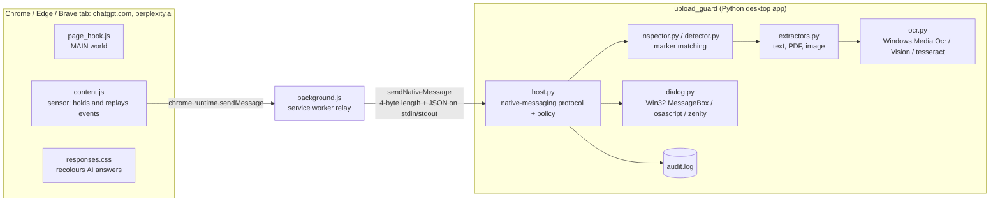
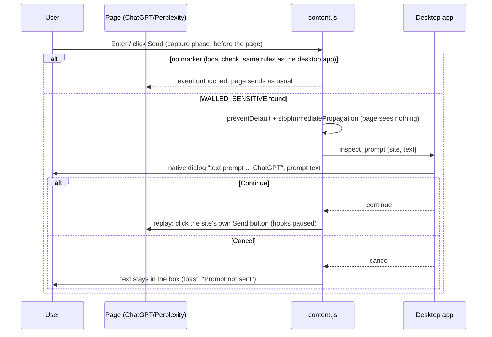

# Architecture

## 1. The core question: where can a prompt or upload be stopped?

The data has to be checked **before it is transmitted**, and **Cancel must leave the web app working** (the user can edit and resend). That rules out most places:

| Interception point | Sees content before sending? | Can cancel cleanly? | Verdict |
| --- | --- | --- | --- |
| Network proxy / TLS interception (e.g. mitmproxy) | Only by installing a root certificate and decrypting all traffic | No. Blocking a request after the page sent it leaves the app in an error state, and ChatGPT may clear the composer | Rejected: invasive, fragile, poor UX |
| OS-level hooks (keyboard / clipboard / file dialogs) | Partly: it can't tell "typing" from "sending", or which site a file goes to | No | Rejected |
| **Inside the page** (browser extension content script) | **Yes.** It sees the exact text in the prompt box and the exact `File` objects at the moment of sending | **Yes.** It simply doesn't let the event through, so the page never knows | **Chosen, as a thin sensor only** |

The brief also asks for a **desktop application** with a **native dialog**. A web page can only show HTML popups, so the decision-making half has to be a desktop program. The two halves talk over **Chrome Native Messaging**, the browser's built-in, supported channel between an extension and a local app.

## 2. Components

| Part | Job |
| --- | --- |
| `extension/content.js` | Capture-phase listeners on `window`, registered at `document_start`, so they run before the site's own code. Holds prompt sends (Enter, Send button, form submit) and uploads (file input, drop, paste); replays or drops them |
| `extension/page_hook.js` | Runs in the page's own JS world. Attaches a *detached* `<input type=file>` to the page right before its picker opens, so its events can be seen |
| `extension/responses.css` | Recolours AI answers using stable `data-` attributes (ChatGPT `data-message-role="assistant"`, Perplexity `data-renderer="lm"` outside the user's message bubble) |
| `extension/background.js` | Relays requests to the native host. Only content scripts can't call native messaging directly. Rejects senders other than the two sites |
| `upload_guard/host.py` | Reads Chrome's message format, runs inspection, applies the policy, shows the dialog, writes the audit log |
| `upload_guard/extractors.py` | Detects the file type from its first bytes (not its name) and extracts text: decoded text, the PDF text layer (OCR for scanned pages) and image OCR plus metadata |
| `upload_guard/ocr.py` | The operating system's own OCR: `Windows.Media.Ocr` via PowerShell, the macOS Vision framework via JXA, `tesseract` as fallback |
| `upload_guard/dialog.py`, `taskdialog.py` | Native Continue/Cancel dialog. On Windows: a **Task Dialog**, the modern native dialog Windows uses for its own security prompts (warning banner, heading, two command-link buttons with explanations, live auto-cancel countdown), loaded from Common Controls v6 through a runtime activation context. It falls back to `MessageBoxTimeoutW` with the OK button renamed to "Continue". Topmost; Cancel is the default button |
| `upload_guard/installer.py` | Registers the host for Chrome, Edge, Brave and Chromium (HKCU registry on Windows, `NativeMessagingHosts` folders elsewhere). Only the extension's fixed ID is allowed |

## 3. Prompt interception

- **Clean prompts are never delayed.** The extension checks locally with exactly the same rules as `detector.py`, and only calls the desktop app when the marker is present.
- **Replay** uses the site's own Send button (falling back to `form.requestSubmit()`, then a synthetic Enter). The prompt is sent byte-for-byte as typed: nothing in the composer is modified.
- While a dialog is open, further send attempts are swallowed, so a double Enter can't sneak a prompt through.

## 4. File interception

Every upload path converges on the same check:

| Path | Hooked event | Replay on Continue | On Cancel |
| --- | --- | --- | --- |
| File picker | `input` + `change` on `<input type=file>` (both held) | dispatch `input` + `change` again; the `FileList` is kept | `input.value = ''` (user can pick again) |
| Several files | same | replay with a new `FileList` of the allowed files only | flagged files removed |
| Drag and drop | `drop` | new `DragEvent('drop')` with the allowed files on the same target | `dragleave` to clear the drop overlay |
| Paste (screenshots) | `paste` with files | new `ClipboardEvent('paste')` with the allowed files plus the original text data | nothing pasted |

Each file is read in the page (`FileReader`), sent to the desktop app as base64, and inspected:

1. **Type from content.** The first bytes decide the type (`%PDF-`, PNG/JPEG/GIF/BMP/TIFF/WebP signatures), so a renamed file is still read correctly.
2. **Text:** UTF-8, UTF-16 (BOM) or Latin-1.
3. **PDF:** the text layer per page via `pypdf`. A page with almost no text is treated as scanned, and its embedded images are OCR'd. Document properties (title, keywords) are checked too.
4. **Image:** OCR with the OS engine, plus printable metadata (PNG text chunks, EXIF comments).
5. **Matching:** both sides are folded to a canonical form (upper case; OCR look-alikes `0→O 1→I 5→S`; non-letters removed), so `WALLED SENSITIVE`, a marker split over two lines, and `WA11ED_SENS1TIVE` all match. Near misses (`WALLED` alone, `WALLED_SENSITIV`) don't.

The dialog names the file, its type and where the marker was found ("page 2", "image text (OCR)"), with the matching line.

## 5. Response recolouring

`responses.css` is injected into both sites. It's active while `<html>` has the class `upload-guard-color`, and takes its colour from a CSS variable set from the popup's settings. Selectors target **stable data attributes**, not the generated class names both sites use:

- **ChatGPT:** `[data-message-role="assistant"] [data-assistant-markdown-root]` (2026 layout) and `[data-message-author-role="assistant"] .markdown` (earlier layout).
- **Perplexity:** `[data-renderer="lm"]`, excluding `[data-message-bubble]`, because Perplexity renders the user's own question with the same renderer.

CSS is applied instantly to every message, including ones that stream in later, with no DOM polling and no effect on page scripts.

## 6. Reliability and failure handling

| Situation | Behaviour |
| --- | --- |
| Desktop app not installed / crashed | Fail-closed by default: flagged prompts and uploads are blocked with an on-page notice. Switchable to fail-open in the popup |
| Dialog left unanswered | Auto-**Cancel** after 120 s (configurable) |
| Supported file can't be read (password-protected PDF, OCR unavailable) | User is asked ("File could not be checked"); `unreadable_policy` can make that allow/block |
| Unsupported file type (zip, docx…) | Not in scope; passes through untouched |
| File over 50 MB | Not sent for inspection; treated as "could not be checked" |
| Malformed native message | Reported as an error reply; the host keeps running |
| Extension reloaded while a page is open | The old content script's calls fail, which is treated as "app not reachable" (fail-closed) |

## 7. Security notes

- The native host accepts messages **only from this extension's fixed ID** (`allowed_origins`). The service worker also rejects any sender that isn't one of the two sites or its own popup.
- Nothing leaves the machine: inspection and OCR run locally.
- The audit log stores a **SHA-256 of the content**, never the content.
- The dialog defaults to **Cancel** (Enter cancels), stays on top, and an unanswered dialog cancels.
- The host writes nothing to stdout except protocol messages (stdout is redirected for the session) and logs to a file, so a stray print can't corrupt the channel.
