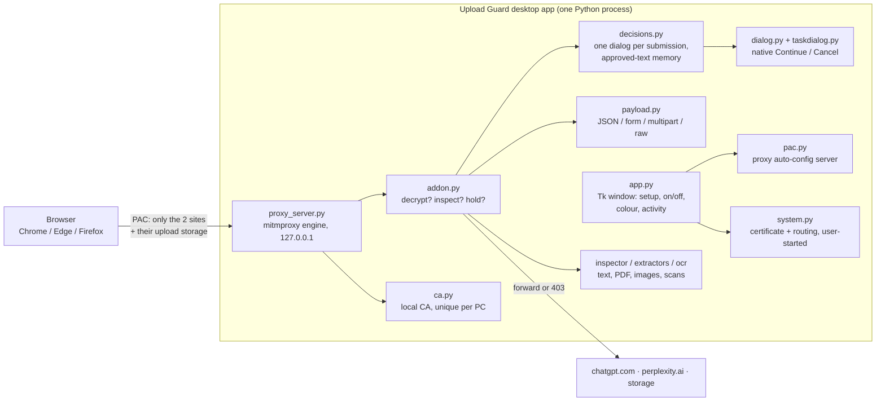

# Architecture

## 1. Constraint and approach

The application must be a **standalone desktop application**: no browser extension, plugin or add-on, not even as a helper. It must still see a prompt or a file **before it is transmitted**, ask in a **native dialog**, and **recolour AI responses** inside two web apps running in an ordinary browser.

| Approach | Before transmission? | Native dialog? | Recolour pages? | Verdict |
| --- | --- | --- | --- | --- |
| Browser extension | yes | via a helper | yes | **Not allowed** by the brief |
| OS input hooks + UI Automation (keyboard, mouse, accessibility tree) | partly (misses drag-and-drop and paste; can't read files reliably) | yes | **no** | Rejected |
| App-controlled browser (DevTools protocol) | yes | yes | yes | Rejected: only in a browser window the app starts, and it's code injected into the page |
| **Local inspecting proxy** | **yes: every byte the browser sends** | **yes** | **yes: stylesheet added in transit** | **Chosen** |

A local proxy is how enterprise DLP products inspect traffic to AI services. Everything the browser sends to the two sites passes through the desktop app, which can read it, hold it, and then forward or refuse it.

## 2. Components



| Module | Job |
| --- | --- |
| `app.py` | The desktop window. It starts the engine, walks through the two setup steps (each user-started and reversible), sets the response colour, and shows live activity and counts. Closing it turns routing off. |
| `proxy_server.py` | Runs mitmproxy (TLS, HTTP/1.1, HTTP/2, WebSockets) on its own asyncio thread |
| `addon.py` | The guard. `tls_clienthello` decides which connections to decrypt; `request` inspects and holds sends and uploads; `response` learns upload hosts and file names and adds the colour stylesheet |
| `payload.py` | Turns a request body into "prompt text" and "files" (JSON, form-encoded, multipart, raw upload) |
| `decisions.py` | One dialog per submission, shared by duplicate requests; remembers approved text so tracking beacons repeating it can pass; records the audit log |
| `inspector.py`, `extractors.py`, `ocr.py`, `detector.py` | Marker detection in text, PDFs (text layer and scanned pages) and images (OS OCR), tolerant of OCR and PDF noise |
| `dialog.py`, `taskdialog.py` | Native dialog: Windows Task Dialog (MessageBox fallback), macOS `display dialog`, Linux `zenity` |
| `pac.py` | Serves the proxy auto-config file that routes only the protected sites to the proxy |
| `system.py` | Certificate install/remove (CurrentUser root store / login keychain) and per-user PAC routing on/off, restoring the previous value |
| `ca.py` | Creates the local CA ("Upload Guard local inspection CA") once per PC |
| `browser.py` | "Open protected browser": a separate profile that uses the proxy and trusts only this CA's public key, with no system change |

## 3. What gets decrypted

1. **Routing (PAC):** the browser asks the PAC file about every host. It answers "the local proxy" only for `chatgpt.com`, `chat.openai.com`, `perplexity.ai` and the storage domains they upload to; everything else is `DIRECT` and never reaches Upload Guard.
2. **Decryption (per connection):** in `tls_clienthello` the add-on looks at the server name. It decrypts only the protected sites, storage hosts that look like theirs, and storage hosts **a protected site named in a response** (an upload URL), which it learns at runtime. Everything else routed to it passes through still encrypted.

## 4. Request lifecycle

```mermaid
sequenceDiagram
  participant B as Browser
  participant P as Upload Guard proxy
  participant U as User (native dialog)
  participant S as ChatGPT / Perplexity
  B->>P: POST send (prompt) or upload (file bytes)
  P->>P: parse body: prompt text? files?<br/>inspect files: text / PDF / OCR
  alt nothing sensitive
    P->>S: forward unchanged (no delay you can notice)
  else marker found
    P->>U: native dialog (prompt text, or file name, type, where found)
    alt Continue
      P->>S: forward the original bytes
      S-->>B: normal response
    else Cancel (or 120 s timeout)
      P-->>B: 403 "Blocked by Upload Guard" (answered locally)
      Note over B: the request never left the PC;<br/>the site keeps the text in the box
    end
  end
```

- **Prompts:** both sites send the new message in a `POST`, and the proxy reads it before forwarding. Discovery on the live sites found ChatGPT's send endpoint (`/unauth-mweb/conversation/updates` logged out, `/backend-api/f/conversation` logged in) and Perplexity's (`/rest/sse/perplexity_ask`, field `query_str`). The add-on doesn't depend on these paths: any send to the site carrying the marker is held.
- **Files** travel in one of two ways, and both are covered. **Multipart** posts carry the file name in each part. **Raw uploads** to cloud storage carry no name, so the add-on uses the name the site announced just before (`{"file_name": …, "file_size": …}`), matched by upload URL or size, so the dialog can show the real file name.
- **Duplicates:** a single send can produce several requests with the same text. They all wait for **one** dialog. After it closes, a duplicate within ~1 to 3 s reuses the answer; a later resend is a new attempt and gets a new dialog, so Cancel never blocks a deliberate retry.
- **Tracking beacons:** discovery showed Perplexity's analytics beacon repeating the prompt text. Tracking requests never open a dialog. They wait while a dialog is open on that site, and then go through **only if the same text was approved**; otherwise they're dropped (204). A cancelled prompt can't leak through telemetry.

## 5. Response recolouring

As the two sites' HTML pages pass through the proxy, the add-on inserts one `<style>` block before `</head>`. Both sites serve their HTML with `no-store`, so every page load is recoloured. It targets stable `data-` attributes: ChatGPT `[data-message-role="assistant"] [data-assistant-markdown-root]`, and Perplexity `[data-renderer="lm"]` *excluding* `[data-message-bubble]`, because Perplexity renders the user's own question with the same renderer. If a page's Content-Security-Policy restricted inline styles, the add-on would add exactly this block's SHA-256 hash to `style-src`. Neither site does so today, and a hash is never added next to `'unsafe-inline'`, where it would disable the site's own inline styles.

## 6. Failure handling

| Situation | Behaviour |
| --- | --- |
| Dialog unanswered | Cancel after 120 s (configurable) |
| Supported file can't be read (password-protected PDF, OCR failure, missing Pillow) | Recorded as "could not be checked" and the user is asked (`unreadable_policy`); never treated as clean |
| Unsupported file type (zip, docx…) | Out of scope; forwarded |
| Upload Guard stops while routing is on | The two sites don't load (no DIRECT fallback in the PAC): fail closed. Closing the app normally restores the previous proxy setting. |
| Upstream certificate invalid | The connection fails as it would without Upload Guard (upstream verification stays on) |
| Several files or prompts at once | Each waits independently; dialogs can be answered in any order |

## 7. Security

- The proxy listens on `127.0.0.1` only.
- The CA is generated per PC, the key never leaves it, it's used only for the hosts above, and it's removable from the app.
- System changes (certificate trust, PAC routing) are started only by the user, explained in the window, and reversible; the previous proxy setting is backed up and restored.
- Inspection is local; the audit log stores hashes, not content.
